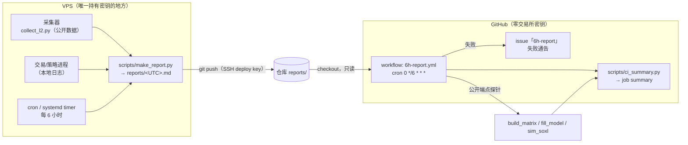

# CI/CD：每 6 小时汇报工作进展 / 交易日志 / 关键发现

本文说明 `nt-pairs` 的自动汇报链路：**VPS 侧产出报告并推送 → GitHub Actions 只读汇总 → 失败开 issue**。
贯穿全文的一条硬约束：**任何密钥、token、密码、私钥都不进仓库、不进 CI 日志。**

---

## 1. 链路总览



要点：

| 环节 | 谁持有凭据 | 说明 |
|---|---|---|
| VPS 采集/交易进程 | 交易所密钥（仅 VPS，env，不入库） | 与本链路无关，但日志会被报告引用 |
| VPS → 仓库推送 | **SSH deploy key**（私钥只存 VPS） | 私钥路径由 `NT_REPORT_SSH_KEY` 指定，不进脚本 |
| CI 汇总 | **只有内置 `GITHUB_TOKEN`** | 用于写 issue；不读交易所数据、不下单 |
| CI 探针 | **无凭据** | 只访问 HL / Lighter / OKX 的公开端点 |

CI 是**只读**的：它不 push、不改分支、不下单。

---

## 2. 触发矩阵

| 事件 | `unit-tests` | `report`（汇总 + summary） | `notify`（开 issue） |
|---|---|---|---|
| `schedule`（`0 */6 * * *`，UTC 00/06/12/18 点） | 跳过 | ✅ 运行 | 仅失败时 |
| `push` 到 `main` | ✅ 运行 | ✅ 运行 | 仅失败时 |
| `push` 到其它分支 | ✅ 运行 | 跳过 | 仅失败时 |
| `pull_request` | ✅ 运行（纯逻辑快测） | 跳过（不刷屏） | 仅失败时 |
| `workflow_dispatch`（手动补跑） | 跳过 | ✅ 运行 | 仅失败时 |

`unit-tests` 只装 `pytest` + `pyyaml`，不装 `nautilus_trader`（纯逻辑内核不需要它）。

装配层 / 策略层的测试（`nt_pairs.live_node` / `live_runner` / `strategy` / `runtime`）需要
`nautilus_trader>=2.0.0rc6`（含 Hyperliquid / Lighter 适配器）。`tests/conftest.py` 在**收集阶段**
按测试文件实际的 import 逐个探测：缺 nautilus（或版本太老、没有对应适配器）时，
把这些模块整份跳过并在终端摘要里列出，而不是让 `ModuleNotFoundError` 在 import 阶段
**中断整个 suite 的收集**（那会连纯逻辑测试一起变红）。

`report` 的失败判定有两个来源：

1. 探针失败 → `ci-out/probe_exit.txt` 非 0；
2. summary 渲染返回 **3** → `reports/` 里没有报告，或最新报告超过 24 小时（VPS 侧 cron 挂了）。

两者都会让 `report` job 失败，进而触发 `notify`。

---

## 3. summary 里渲染什么

`scripts/ci_summary.py` 把两段内容拼进 GitHub job summary（页面上直接可见）：

**A. VPS 6 小时报告**（读 `reports/<最新>.json` 旁挂文件）

- 报告文件与生成时间、统计窗口；
- 采集合计（窗口内 / 累计）、重复收盘率（按场所）；
- 成交 / 未成交计数、风控事件数、异常行数；
- 异常摘要（去重后的 top 异常，已脱敏）；
- 新发现清单（日志里的 `FINDING:` 行）。

**B. 只读公开数据探针**（本 run 现算）

- 矩阵：覆盖倍数、`b*`、30d p95 基差、深度容量、是否可交易；
- 成交率：`p_fill` 代理（挂 HL / 挂 Lighter）、贴价队列规模；
- SOXL 事件级回放：捕获、胜率、**净 EV（bps/轮）**、p_fill 情景、滑点曲线、容量上限。

> 探针数字是**模型输出**，不是实盘结果；`p_fill` 只是单次贴价队列快照的代理。

---

## 4. 失败处理

| 失败 | 检测方式 | 动作 |
|---|---|---|
| 单测失败 | `unit-tests` job | `notify` 开/更新 issue「6h-report」 |
| 公开数据探针失败（网络/接口变更） | `probe_exit=1` | 同上，issue 正文指出看 artifact `6h-report-summary` 的 `ci-out/*.log` |
| VPS 侧 cron 没跑 / deploy key 失效 | `summary_exit=3` | 同上，正文明确指向 VPS 侧 |
| summary 渲染异常 | `summary_exit∉{0,3}` | 同上 |

issue 策略：

- 标题**固定**为 `6h-report`；
- 已存在 → **追加评论**（保留历史，不刷屏）；
- 不存在 → 新建；
- 关闭 issue 由人工判断（系统不自动关，避免掩盖反复失败）。

每次失败都会把 `probe` / `summary` 的退出码和 run 链接写进 issue 正文。

> ⚠️ **在 captain 完成 §7 的 ①（deploy key）之前**，VPS 侧还没有任何报告推进仓库，
> 于是每次 schedule 都会因为「`reports/` 里没有报告」而开/更新 issue。
> 这是**有意为之的信号**（不是误报），完成 ① 之后自动消失；不需要提前关掉。

---

## 5. 手动补跑

```bash
# 1) 手动触发整条链路（等价于一次 schedule）
gh workflow run 6h-report.yml --ref main

# 2) 只重跑 VPS 侧那份报告（CI 不做这件事，必须在 VPS 上）
ssh vps 'cd /opt/nt-pairs && ./scripts/vps_report_cron.sh'

# 3) 只在本地试跑报告生成（不推送）
python scripts/make_report.py --logdir /var/log/nt-pairs --out /tmp/r.md --json-out /tmp/r.json

# 4) 本地看 summary 长什么样
python scripts/ci_summary.py --reports reports \
  --matrix data/matrix.json --fill data/fill_model.json --sim data/soxl_sim.json
```

---

## 6. VPS 侧安装 cron

```bash
# 1) 拉代码
cd /opt/nt-pairs && git pull

# 2) 生成 deploy key（见 §7 的注意事项）
ssh-keygen -t ed25519 -C "nt-pairs-report" -f ~/.ssh/nt_pairs_report -N ""

# 3) 加到 ssh config（可选，但推荐，避免 known_hosts 提示）
cat >> ~/.ssh/config <<'EOF'
Host github.com
  HostName github.com
  User git
  IdentityFile ~/.ssh/nt_pairs_report
  IdentitiesOnly yes
EOF
ssh -T git@github.com   # 第一次会问是否信任 github.com 的主机密钥

# 4) cron（每 6 小时，避开整点太多：17 分）
crontab -e
# 加入这一行：
17 */6 * * * /opt/nt-pairs/scripts/vps_report_cron.sh >> /var/log/nt-pairs/report_cron.log 2>&1

# 5) 验证一次（会真的推一份报告到仓库）
/opt/nt-pairs/scripts/vps_report_cron.sh
```

用 systemd timer 的话见 `docs/DEPLOYMENT_GUIDE.md` 的采集器一节，timer 单元写法相同
（`OnCalendar=*-*-* 00,06,12,18:17:00`）。

脚本只推 `reports/` 目录；仓库里其它文件一律不动。

---

## 7. 需要 captain 手工做的事（两件）

### ① 生成 deploy key 并注册到仓库（**必须**）

CI 不持有任何密钥，报告能不能进仓库完全取决于这一步。

```bash
# 在 VPS 上
ssh-keygen -t ed25519 -C "nt-pairs-report" -f ~/.ssh/nt_pairs_report -N ""
cat ~/.ssh/nt_pairs_report.pub
```

然后在 GitHub 上：

1. 仓库 → **Settings → Deploy keys → Add deploy key**；
2. Title 填 `nt-pairs-report`；
3. Key 粘贴上一步的 `.pub` 内容；
4. **不要**勾 “Allow write access”（只读足够 —— 推送用的是 `git push`，但仓库若已允许写也不需要改）；
5. 把 VPS 的公钥加进仓库的 **Settings → Deploy keys** 后，
   确认 VPS 上 `git remote -v` 指向 `git@github.com:jssyxd/nt-pairs.git`。

> 若 GitHub 对该账号禁用了 SSH 推送，就退回到 **Fine-grained PAT**：
> 在 VPS 上用 `git credential` helper 存 token（**不要**写进脚本或仓库文件），
> 并设置 `NT_REPORT_SSH_KEY=`（空）以免脚本去用不存在的 key 文件。

### ② 设置仓库 secrets（**当前实现零 secret，可跳过**）

本 workflow 只用 GitHub 内置的 `GITHUB_TOKEN`（`github.token`），**不需要**任何仓库 secret。

只有将来要做「CI 自己给 VPS 发指令」这类事，才需要在
**Settings → Secrets and variables → Actions** 里加 secret，并且：

- workflow 里只写 **名字**（`${{ secrets.NAME }}`），**永远不要写值**；
- 值只在 VPS 的环境文件（`/etc/nt-pairs/secrets.env`，`chmod 600`）或 GitHub secrets 里；
- 不要 `set -x` 打印环境变量，不要把 `$GITHUB_ENV` 内容回显。

---

## 8. 报告格式与脱敏

`scripts/make_report.py` 生成的 Markdown 章节：

1. 进程状态（每个日志文件：最后写入时间、距今、状态、行数）；
2. 采集样本数与重复收盘率（按场所 + 矩阵口径的重复收盘率表）；
3. 基差统计（可交易对的 30d p95）；
4. 成交 / 未成交计数；
5. 净 EV 估计（事件级回放 + 会话分层 + p_fill 情景 + 容量）；
6. 风控事件次数；
7. 异常摘要（去重计数）；
8. 新发现清单；
9. 边界说明。

脱敏规则（`scripts/make_report.py` 的 `redact()`）：任何
`api_key` / `secret` / `passphrase` / `private_key` / `token` / `wallet_address` / `account_address`
赋值、任何 `0x` + 40 位十六进制地址、任何 32 位以上的纯十六进制串，
一律替换成 **「前 6 位 + …」**。CI 日志里同理：workflow 从不打印环境变量。

日志约定（VPS 侧写日志时按这个来，报告才能统计准）：

| 约定 | 例子 |
|---|---|
| 成交事件 | `event=fill qty=100 px=62.88` |
| 未成交事件 | `event=no_fill reason=queue_ahead` / `event=cancel` |
| 风控事件 | `event=risk_rejected` / `risk margin_low` |
| 异常 | `ERROR ...` / `event=error ...` |
| 新发现 | `FINDING: <一句话>` |
| 关键数字 | `basis=17.4` / `net_ev_bps=3.4` / `p_fill=0.62` |

没有这些约定，报告仍会生成，但成交/未成交计数会偏 0 —— 这是**诚实的边界**，
不是 bug。

---

## 9. 已知边界

- 报告**只统计公开数据与本机日志**；不含交易所凭据、私钥、账户地址。
- 净 EV 来自事件级回放（`sim_soxl.py`），**不等于**实盘可得。
- `p_fill` 是单次贴价队列快照的代理，必须逐笔采样（中位数）才可信。
- CI 探针每 6 小时打一次公开端点，注意各家的速率限制。
- 报告的「重复收盘率」有两个口径：L2 快照的中位价未变比例（代理）与矩阵的小时收盘比例（真实），
  报告里分别标注。
